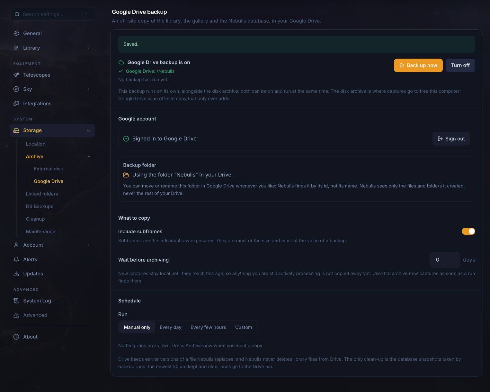

# Backing up to Google Drive

Besides the disk archive, Nebulis can keep an off-site copy in a folder of your Google Drive. The two are independent: each has its own switch and schedule, both can be on, and they can run at the same time.

- **The disk archive** (Settings → Storage → Archive → External disk) is where captures go to free this computer. It can prune itself, remove local subframes once they are archived, and restore.
- **The Google Drive backup** (Settings → Storage → Archive → Google Drive) is an off-site copy that only ever adds.

One Google Drive backup run sends:

- **The library.** Every object folder with its sessions, `_archive/` calibration frames, `RESTACKED/`, and the other top-level folders. Subframes are included if you turn that on.
- **The gallery.** The finished images in each object's `processed/` folder.
- **The Nebulis database.** Each run takes a fresh snapshot and uploads it to `.nebulis-database/`. Upgrade and manual snapshots are also uploaded as soon as they are taken.

The folder in Drive has the same layout as the library. You can download it and open it in Siril or PixInsight without Nebulis.

Setup has two parts: you create a Google "OAuth client" once (about 10 minutes, free), then you connect Nebulis to it. Nebulis then keeps the backup in a `Nebulis` folder in your Drive. The same steps, with direct links, are in Nebulis itself: open **Settings → Storage → Archive → Google Drive** and expand **First time? How to get a client ID and secret**.

## Part 1: Create your Google access (once)

### Why this step exists

Google lets an app use Drive only through an *OAuth client*: a pair of identifiers (a **client ID** and a **client secret**) that tell Google which app is asking. Big apps ship their own. Nebulis is self-hosted, so each install creates its own, in your Google account. That way:

- no one else's app has access to your Drive,
- you are not sharing a quota with every other Nebulis user,
- you can revoke access at any time from your Google account.

It is free. Personal use of the Drive API costs nothing, and Google does not ask for payment details.

### Before you start

- Use a computer. The Google Cloud Console is hard to use on a phone.
- Sign in to Google with the account whose Drive you want to back up to. If you have several Google accounts, check the avatar at the top right of each page.
- Google translates the console. The button names below are the English ones; the in-app guide gives them in your language.

### Step 1: Create a project

Open [Create a project](https://console.cloud.google.com/projectcreate).

Create a new project just for Nebulis, even if you already have one in Google Cloud:

- **Everything stays together.** The Drive API (Step 2) and the client (Step 5) must be in the same project. With a dedicated project, there is only one place to check.
- **Nothing else is mixed in.** Your other projects, their APIs and their clients are not touched.
- **Easy to undo.** Deleting the project later removes Nebulis's access in one go.

1. If this is your first visit, Google asks you to accept its terms of service. Accept them.
2. In **Project name**, type `Nebulis`. Leave **Location** as it is.
3. Click **Create** and wait a few seconds.
4. At the top left of the page, check that the selected project is now **Nebulis**. If not, click the project selector and choose it. All the next steps happen inside this project.

### Step 2: Turn on the Google Drive API

Open [Google Drive API](https://console.cloud.google.com/apis/library/drive.googleapis.com).

1. At the top left, check that **Nebulis** is still the selected project. Google sometimes opens this page on another project.
2. Click **Enable**. The button then turns into **Manage**.

Do not skip this step. Signing in to Google works without it, so nothing looks wrong at first. But when Nebulis tries to list or create a folder, Google refuses with "The Google Drive API is turned off in the Google Cloud project of this client".

Turning the API on only allows apps in your project to talk to Drive. It does not give anyone access to your files. It can take a few minutes to take effect.

### Step 3: Describe the app

Open [Google Auth Platform](https://console.cloud.google.com/auth/overview) and click **Get started**. Google asks four short questions:

1. **App information.** App name: `Nebulis`. User support email: pick your address. Click **Next**.
2. **Audience.** Choose **External**. ("Internal" only exists for Google Workspace organisations.) Click **Next**.
3. **Contact information.** Type your address again. Click **Next**.
4. **Finish.** Tick the box to accept the user data policy, then click **Continue** and **Create**.

### Step 4: Publish the app

Open [Audience](https://console.cloud.google.com/auth/audience). Under **Publishing status**, click **Publish app**, then **Confirm**.

- **No review is needed.** Nebulis asks only for the `drive.file` permission (files it creates itself), which Google does not consider sensitive.
- **Why publish?** An app left in **Testing** works only for the addresses listed under **Test users**, and Google signs it out every 7 days. You would then have to sign in again from Settings every week.

If you prefer to stay in Testing, click **Add users** under **Test users** and add your own address.

### Step 5: Create the client

Open [Create OAuth client](https://console.cloud.google.com/auth/clients/create).

1. **Application type:** choose **TVs and Limited Input devices**. This is the important one: Nebulis signs in with a short code, and Google refuses that sign-in for any other type ("Web application", "Desktop app"…).
2. **Name:** `Nebulis`.
3. Click **Create**.
4. A window shows the **Client ID** (it ends in `.apps.googleusercontent.com`) and the **Client secret**. Copy both now, for example into a password manager. Google may not show the secret again; if you lose it, create a new client.

That is all for Google Cloud.

## Part 2: Connect Nebulis

1. In Nebulis, go to **Settings → Storage → Archive → Google Drive**. It is its own page, next to **External disk**: the disk archive does not need to be set up, and is not changed.
2. Under **Google account**, paste the **client ID** and **client secret**, then click **Sign in with Google**.
3. Nebulis shows a code such as `ABCD-EFGH` and an address (`google.com/device`). On any device, phone or computer, open that address, type the code, choose your Google account and click **Allow**.
   - If Google warns that the app is not verified, click **Advanced**, then **Go to Nebulis**. It is the app you created in Part 1.
4. Back in Nebulis, the page now says **Signed in as …**. Under **Backup folder**, Nebulis creates a folder named `Nebulis` at the top of My Drive, or reuses the one it made earlier. There is nothing to choose.
5. Choose **What to copy** and the **Schedule**, then click **Save**.
   - **Include subframes** is off by default: subframes are most of a library, and a free Google account has 15 GB.
   - The schedule works like the archive's: by hand, every day at a set time, every few hours, or a custom cron expression.
6. Click **Turn on**. This writes the backup marker (`.nebulisarchive`) into the folder.

From then on, backups follow the schedule you chose, or you can start one with **Back up now**. **Stop** ends a run at the next file; what was uploaded stays.

### Moving the folder, and why Nebulis makes its own

You can move or rename the `Nebulis` folder in Google Drive whenever you like, for example into `Astro/Backups`. Nebulis remembers the folder by its id, not its name or place, so it keeps finding it.

Nebulis asks Google only for `drive.file`, the narrowest Drive permission: it can see and change the files and folders **it created**, and nothing else in your Drive. It could not list your own folders, so it makes its own instead of offering a folder picker.

## What Nebulis can and cannot touch

- **Ownership.** As with the disk archive, Nebulis writes only to a folder whose marker carries this install's ID. Taking over a folder used by another install asks for confirmation first.
- **Runs alongside the archive.** A Google Drive backup only reads the library, so it does not wait for a disk archive run, an import or a sync. It does not start while library files are being moved or deleted (a library move, a subframe purge, a repair or a reorganize).
- **Verification.** A file is recorded only after the checksum Drive reports matches the one Nebulis computed locally.
- **Large files.** Uploads go in 32 MiB pieces. An interrupted piece resumes from where Drive stopped instead of starting the file again.
- **Deletion.**
  - Drive keeps earlier versions of a file that Nebulis replaces.
  - Nebulis never deletes library files from Drive.
  - The only automatic clean-up is the database snapshots taken by backup runs: Nebulis keeps the newest 30 and moves older ones to the Drive bin.
- **Storage.** The client secret and the sign-in token are encrypted at rest with the Nebulis data key and are never returned by the API.

## What stays with the disk archive

- Pruning the archive after N days.
- Removing local subframes once they are archived.
- Browsing and restoring from Settings. To get files back from Google Drive, download them from Drive.

## Troubleshooting

| What you see | What to do |
|---|---|
| "Google refused to start the sign-in … invalid_client" | The client is not of type **TVs and Limited Input devices**, or the ID was pasted incompletely. Create a new client (Part 1, Step 5). |
| "Access blocked: … has not completed the Google verification process" | The app is in **Testing** and your address is not a test user. Publish the app (Step 4) or add yourself under **Test users**. |
| "The Google Drive API is turned off in the Google Cloud project of this client" (or Google's "Google Drive API has not been used in project … or it is disabled") | Step 2 was skipped, or done in another project. Select the **Nebulis** project at the top left of the console, open the [Google Drive API](https://console.cloud.google.com/apis/library/drive.googleapis.com) page and click **Enable**. Wait a minute, then click **Try again** under **Backup folder**. |
| Signed out every week | The app is still in **Testing**. Publish it (Step 4) and sign in again. |
| "The Google Drive backup folder was not found" | The folder was deleted or emptied from the bin, or you signed in with another Google account. Open **Settings → Storage → Archive → Google Drive**: Nebulis makes a new `Nebulis` folder. Then click **Turn on** again. |

## Signing out

Open **Settings → Storage → Archive → Google Drive** and click **Sign out**. This revokes the token with Google. The files in Drive stay where they are, and Nebulis remembers the folder. You can also remove access from your Google account at [myaccount.google.com/permissions](https://myaccount.google.com/permissions).
